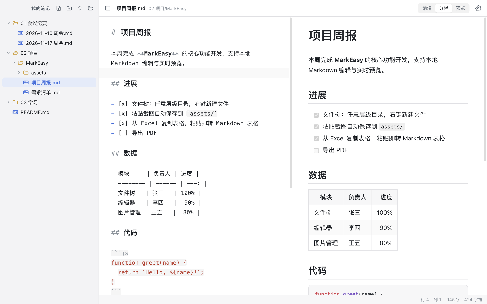
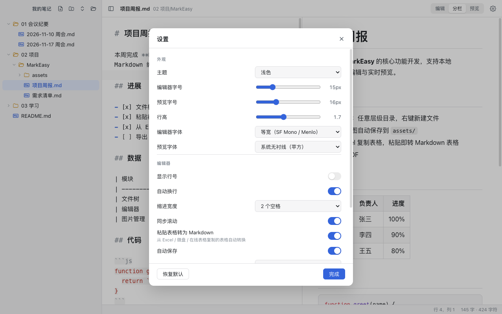
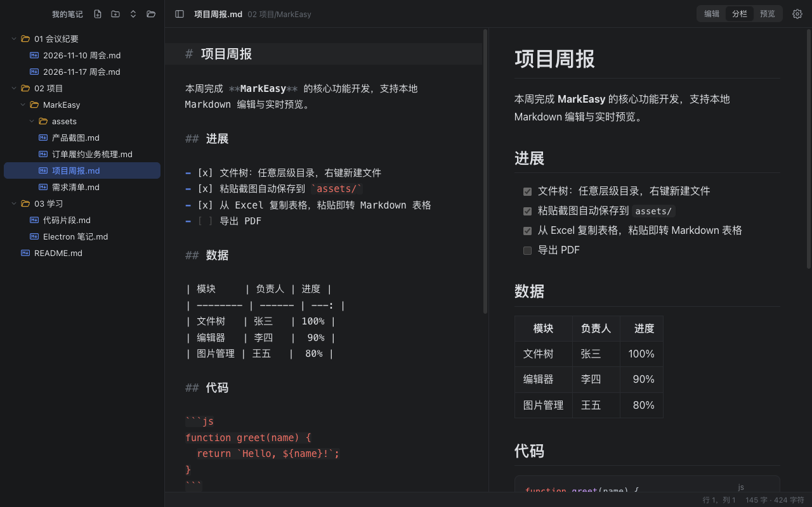

<div align="center">


# MarkEasy

**本地优先 · 轻量简洁 · 开箱即用 —— 跨平台的 Markdown 编辑与预览工具**


`文件树` · `右键新建` · `分栏实时预览` · `截图粘贴自动转存` · `Excel 表格粘贴转 Markdown` · `图片查看器` · `代码高亮` · `GFM 任务列表` · `深浅色主题` · `字体字号设置` · `自动保存` · `同步滚动` · `外部修改自动刷新`

</div>

MarkEasy 是一款基于 Electron 的桌面 Markdown 编辑器，支持 macOS 与 Windows。打开任意文件夹即可当作笔记库使用，左侧文件树管理目录，中间写、右边看。
**所有文件都是普通的 `.md`，保存在你自己的硬盘上** —— 无账号、无云端、无私有格式，换任何编辑器都能继续用。



---

## 下载安装

| 平台 | 架构 | 安装包（点击直接下载） |
| --- | --- | --- |
| **macOS** | Apple Silicon (arm64) | [MarkEasy-1.0.0-arm64.dmg](https://github.com/MarvenGong/markeasy/releases/download/v1.0.0/MarkEasy-1.0.0-arm64.dmg) / [MarkEasy-1.0.0-arm64-mac.zip](https://github.com/MarvenGong/markeasy/releases/download/v1.0.0/MarkEasy-1.0.0-arm64-mac.zip) |
| **Windows** 10 / 11 | x64 | [MarkEasy-Setup-1.0.0-x64.exe](https://github.com/MarvenGong/markeasy/releases/download/v1.0.0/MarkEasy-Setup-1.0.0-x64.exe)（安装版） / [MarkEasy-1.0.0-win-x64.zip](https://github.com/MarvenGong/markeasy/releases/download/v1.0.0/MarkEasy-1.0.0-win-x64.zip)（免安装，解压即用） |

历史版本与更新说明见 [Releases](https://github.com/MarvenGong/markeasy/releases)。

> 安装包暂未使用开发者证书签名：
> - **macOS**：首次打开时在「应用程序」中 **右键 → 打开**，或在「系统设置 → 隐私与安全性」中点击「仍要打开」。
> - **Windows**：若出现「Windows 已保护你的电脑」（SmartScreen）提示，点击 **更多信息 → 仍要运行**。

也可以从源码自行构建，见下方 [开发与构建](#开发与构建)。

---

## 为什么选择 MarkEasy？

- **真正的本地优先** — 文件就是磁盘上的 `.md` 明文，目录结构就是文件夹结构，没有数据库、没有锁定
- **零学习成本** — 打开文件夹 → 选文件 → 写，界面只保留必要元素
- **图片不再乱放** — 截图直接粘贴，自动存到文档旁的 `assets/` 并写好相对路径，整个目录拷走图片也不会丢
- **表格不再手敲** — 从 Excel / 企业微信微盘 / 在线表格复制，粘贴即是对齐好的 Markdown 表格
- **原生桌面体验** — 原生菜单、右键菜单与对话框；删除文件进废纸篓 / 回收站；双击 `.md` 直接用 MarkEasy 打开
- **跨平台无差异** — macOS 与 Windows 功能一致，快捷键自动适配 `⌘` / `Ctrl`；保留文件原有换行符（LF / CRLF），多平台协作不产生无意义的改动

---

## 核心功能

### 1. 文件树与目录管理

- **任意层级目录**
  文件树按需逐级加载，再深的目录也不卡；默认只显示 Markdown 文件与文件夹，可在设置中显示全部文件 / 隐藏文件。
- **右键菜单**
  在目录上右键：新建 Markdown 文件、新建文件夹、重命名、移到废纸篓（回收站）、在 Finder（资源管理器）中显示、复制路径。新建时未写扩展名会自动补 `.md`，创建后立即打开；Windows 下会校验非法字符与保留文件名。
- **自动感知外部修改**
  在系统文件管理器或其它编辑器里增删改文件，文件树和已打开的文档都会自动刷新；有未保存修改时不会被覆盖。
- **记住工作现场**
  重启后自动恢复上次打开的文件夹、展开的目录和正在编辑的文件。

### 2. 编辑与预览

- **三种视图** — 仅编辑 / 分栏 / 仅预览，`Mod+1` `Mod+2` `Mod+3` 切换，分栏模式下编辑区与预览区同步滚动
- **GFM 语法** — 表格、任务列表、删除线、围栏代码块、Front Matter
- **代码高亮** — 基于 highlight.js，内置 JavaScript、Python、Java、Go、C/C++、SQL、Shell、JSON、YAML 等 36 种常用语言
- **列表续写** — 回车自动续写有序/无序/任务列表
- **常用格式快捷键** — 加粗、斜体、行内代码、链接、引用
- **查找替换** — 见下方 [快捷键](#快捷键)
- **自动保存** — 停止输入后自动保存（延迟可调），切换窗口时也会保存；关闭自动保存则在切换文件 / 退出时提示

> 下文中的 `Mod` 在 macOS 上为 `⌘`，在 Windows 上为 `Ctrl`。

### 3. 图片：粘贴即转存

- **截图粘贴** — `Mod+V` 粘贴截图（macOS 截图、Windows `Win+Shift+S` 截图均可），图片保存到 **当前文档所在目录的 `assets/`** 下，自动插入
  ``
- **拖拽插入** — 从 Finder / 资源管理器拖图片到编辑器，自动复制到 `assets/` 并插入引用
- **目录可配置** — 图片目录名可在设置中修改（如 `images`、`.assets`）
- **跨平台路径** — 引用统一使用 `/` 分隔的相对路径，同一份笔记在 macOS 与 Windows 上都能正常显示图片
- **应用内图片查看器** — 文件树中单击图片或点击预览区图片即可查看，支持适应窗口 / 原始大小切换、`←` `→` 浏览同目录图片；双击图片用系统默认的看图软件打开


### 4. 表格：从 Excel 粘贴自动转换

从 Excel、WPS、企业微信微盘、腾讯文档或网页中复制表格，直接 `Mod+V`：

```markdown
| 姓名 | 部门   | 备注             |
| ---- | ------ | ---------------: |
| 张三 | 云发票 | 第一行<br>第二行 |
| 李四 | A\|B   | 100              |
```

- 第一行作为表头，合并单元格自动展开，保留左/中/右对齐
- 单元格内换行转为 `<br>`，`|` 自动转义，按中文宽度对齐源码
- 只复制单个单元格时按纯文本粘贴；代码块内不转换
- 需要原始文本时用 **粘贴为纯文本** `Mod+Shift+V`，也可在设置中关闭此功能

### 5. 个性化设置

`Mod+,` 打开设置，修改即时生效并自动保存。

| 分类 | 选项 |
| --- | --- |
| 外观 | 主题（跟随系统 / 浅色 / 深色）、编辑器字号、预览字号、行高、编辑器字体（等宽 / 无衬线 / 衬线）、预览字体 |
| 编辑器 | 行号、自动换行、缩进宽度、同步滚动、粘贴表格转 Markdown、自动保存及延迟 |
| 文件 | 图片保存目录、显示隐藏文件、显示非 Markdown 文件 |

字体会按平台自动选用系统字体：macOS 为 SF Mono / 苹方 / 宋体，Windows 为 Cascadia Mono、Consolas / 微软雅黑 / 宋体。

<table>
  <tr>
    <td></td>
    <td></td>
  </tr>
  <tr>
    <td align="center">设置面板</td>
    <td align="center">深色主题</td>
  </tr>
</table>

---

## 快捷键

| 功能 | macOS | Windows |
| --- | --- | --- |
| 新建 Markdown 文件 | `⌘N` | `Ctrl+N` |
| 新建文件夹 | `⇧⌘N` | `Ctrl+Shift+N` |
| 打开文件夹 | `⌘O` | `Ctrl+O` |
| 保存 | `⌘S` | `Ctrl+S` |
| 设置 | `⌘,` | `Ctrl+,` |
| 切换侧边栏 | `⌘\` | `Ctrl+\` |
| 仅编辑 / 分栏 / 仅预览 | `⌘1` / `⌘2` / `⌘3` | `Ctrl+1` / `Ctrl+2` / `Ctrl+3` |
| 放大 / 缩小 / 重置字号 | `⌘=` / `⌘-` / `⌘0` | `Ctrl+=` / `Ctrl+-` / `Ctrl+0` |
| 撤销 / 重做 | `⌘Z` / `⇧⌘Z` | `Ctrl+Z` / `Ctrl+Y` |
| 粘贴为纯文本 | `⇧⌘V` | `Ctrl+Shift+V` |
| 查找 / 替换 | `⌘F` / `⌥⌘F` | `Ctrl+F` / `Ctrl+H` |
| 加粗 / 斜体 / 行内代码 / 链接 | `⌘B` / `⌘I` / `⌘E` / `⌘K` | `Ctrl+B` / `Ctrl+I` / `Ctrl+E` / `Ctrl+K` |
| 引用 | `⌘/` | `Ctrl+/` |
| 在文件管理器中显示当前文件 | `⌥⌘R` | `Shift+Alt+R` |

应用内的按钮提示、欢迎页等也会按当前平台显示对应的快捷键。

---

## 开发与构建

**环境要求**：macOS 或 Windows，Node.js 18+（开发时使用 Node 22）

```bash
# 安装依赖
npm install

# 启动应用
npm start

# 开发模式（自动打开开发者工具）
npm run dev

# 测试：单元测试（路径/快捷键/文件名校验，含 Windows 路径用例）+ 端到端自测
# 端到端自测会改写系统剪贴板
npm test

# 重新生成 README 截图到 docs/screenshots/
npm run screenshots

# 打包当前平台
npm run dist

# 指定平台打包，输出到 dist/
npm run dist:mac    # dmg + zip（arm64）
npm run dist:win    # NSIS 安装包 + zip（x64），在 macOS 上也可交叉打包
```

> - 所有 npm 脚本通过 `scripts/run-electron.js` 启动，macOS / Windows 终端（含 PowerShell、cmd）下用法一致。
> - 国内网络可在项目 `.npmrc` 中使用 npmmirror 镜像下载 Electron 及 electron-builder 二进制（已默认配置）。

### 技术栈

| 用途 | 依赖 |
| --- | --- |
| 桌面框架 | [Electron](https://www.electronjs.org/) 45 + [electron-builder](https://www.electron.build/) |
| 编辑器 | [CodeMirror 5](https://codemirror.net/5/)（GFM 模式） |
| Markdown 解析 | [marked](https://marked.js.org/) |
| 代码高亮 | [highlight.js](https://highlightjs.org/) |
| HTML 净化 | [DOMPurify](https://github.com/cure53/DOMPurify) |

前端不使用打包器与框架，渲染进程为原生 JavaScript；开启 `contextIsolation` + `sandbox`，所有文件操作通过 preload 暴露的有限 IPC 接口完成，预览内容经 DOMPurify 过滤。

### 平台差异处理

| 方面 | macOS | Windows |
| --- | --- | --- |
| 窗口 | 隐藏式标题栏，红绿灯嵌入工具栏 | 系统原生标题栏与菜单栏 |
| 菜单 | 顶部应用菜单（含「关于」「服务」等） | 窗口菜单栏：文件 / 编辑 / 显示 / 窗口 / 帮助 |
| 双击 `.md` 打开 | `open-file` 事件 | 命令行参数 + 单实例（已打开时交给现有窗口） |
| 路径 | `/Users/...` | 支持盘符、`\` 分隔、UNC 路径，比较时不区分大小写 |
| 删除 | 移到废纸篓 | 移到回收站 |
| 安装包 | dmg / zip，ad-hoc 签名 | NSIS 安装包（可选安装目录、桌面快捷方式）/ zip |

### 项目结构

```
markeasy/
├── build/                    # 应用图标（icon.icns / icon.ico / icon.png）
├── docs/                     # README 图片与截图
├── scripts/
│   ├── run-electron.js       # 跨平台启动 Electron（npm start / test 使用）
│   ├── after-pack.js         # macOS 打包后 ad-hoc 签名
│   ├── unit-test.js          # 单元测试（Node 直接运行）
│   ├── e2e-test.js           # 端到端自测
│   └── screenshot.js         # 生成 README 截图
└── src/
    ├── main/                 # 主进程
    │   ├── main.js           #   窗口、IPC、文件监听、右键菜单、文件关联
    │   ├── menu.js           #   应用菜单与快捷键（按平台生成）
    │   ├── fsService.js      #   目录读取、新建/重命名、图片转存
    │   └── settings.js       #   设置持久化
    ├── preload/preload.js    # 安全暴露给渲染进程的 API
    └── renderer/             # 界面
        ├── index.html
        ├── js/
        │   ├── app.js        #   主控制器
        │   ├── tree.js       #   文件树
        │   ├── editor.js     #   编辑器、图片/表格粘贴
        │   ├── preview.js    #   Markdown 预览
        │   ├── table-paste.js#   表格 → Markdown 转换
        │   ├── image-viewer.js#  图片查看器
        │   ├── settings.js   #   设置面板
        │   ├── ui.js         #   弹窗与提示
        │   └── util.js       #   跨平台路径、快捷键显示、换行符、图标
        └── styles/           #   界面、编辑器、预览样式
```

设置文件位置：

- macOS：`~/Library/Application Support/MarkEasy/settings.json`
- Windows：`%APPDATA%\MarkEasy\settings.json`

---

## 常见问题

**macOS 打开时提示「已损坏，无法打开」或「无法验证开发者」？**
安装包未经 Apple 公证。右键应用选择「打开」即可；仍不行可执行 `xattr -cr /Applications/MarkEasy.app`。

**Windows 安装时提示「Windows 已保护你的电脑」？**
安装包未做代码签名，SmartScreen 会拦截未知发布者。点击「更多信息 → 仍要运行」即可；也可以使用免安装的 zip 版本。

**粘贴的图片存在哪里？**
当前 Markdown 文件所在目录下的 `assets/`（可在设置中修改目录名），引用使用相对路径，移动整个文件夹或换到另一台电脑（包括跨 macOS / Windows）都不会失效。

**在 Windows 上编辑会改掉文件的换行符吗？**
不会。打开时识别文件原有的换行符（LF 或 CRLF），保存时原样还原。

**粘贴表格不想被转换？**
使用 `Mod+Shift+V` 粘贴为纯文本，或在「设置 → 编辑器」中关闭「粘贴表格转为 Markdown」。

**在文件树中看不到图片或其它文件？**
默认只显示 Markdown 文件，在「设置 → 文件」中打开「显示非 Markdown 文件」。

---

## License

[MIT](https://opensource.org/licenses/MIT) © gongminghua
